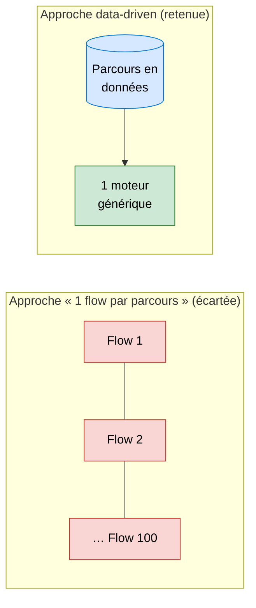

# Parcours métiers — moteur *data-driven* sur Salesforce

> **Statut : tranche verticale implémentée (démo).** Le modèle de données, le moteur générique et deux visualiseurs graphiques existent dans [`force-app/`](force-app/) et sont déployés sur un org de démonstration. Ce dépôt documente l'**approche** (dossier [`doc/`](doc/)) **et** porte désormais une **première mise en œuvre**. Voir [§6 État d'implémentation](#6-état-dimplémentation).

## 1. À quoi sert cette application

Les conseillers d'un **service client** s'appuient sur des **parcours métiers** (scripts guidés) pour traiter les appels : poser les bonnes questions au client, suivre les bifurcations selon ses réponses, donner les conseils adaptés, puis déclencher les actions qui en découlent (prise de rendez-vous, intervention urgente, etc.).

Ces parcours existent aujourd'hui sous forme de **logigrammes** (schémas). L'objectif est de les rendre **exécutables dans Salesforce**, directement depuis la fiche **Compte** ou **Requête (Case)**, pour **guider le conseiller pas à pas** et **créer automatiquement** les enregistrements métier associés.

Il y a **~100 parcours** à terme. L'enjeu n'est donc pas de traiter *un* parcours, mais de les traiter **tous**, et de pouvoir en **ajouter / modifier** sans redéveloppement.

## 2. Le principe : « la donnée décrit, le code exécute »

L'approche naïve — **1 Screen Flow par parcours** — ne passe pas à l'échelle : 100 flows à construire, maintenir et versionner, et une génération qui atteint vite ses limites sur les gros parcours.

Nous avons retenu une **architecture pilotée par la donnée** :

- **Un parcours = des enregistrements** dans des objets custom génériques (sa logique est *de la donnée*, pas du code).
- **Un seul moteur**, générique, **écrit une seule fois**, lit ces enregistrements et déroule le parcours à l'écran.
- **Ajouter un parcours = ajouter des données** — aucun flow ni code spécifique, aucun déploiement par parcours.

## 3. Comment ça fonctionne (grandes lignes)

### Modèle de données

**Objets de définition** (le parcours, saisis une fois) :

| Objet | Rôle |
|---|---|
| `Parcours__c` | L'en-tête d'un parcours (libellé, catégorie, nœud de départ). |
| `Noeud__c` | Une étape : **Question**, **Conseil**, **Action**, **Navigation** (vers un autre parcours) ou **Fin**. |
| `Transition__c` | Un lien orienté entre deux nœuds = **une réponse possible**. L'enchaînement est un **graphe**, pas une liste ordonnée. |
| `ChampSaisie__c` | Les champs d'un écran de saisie (nom, téléphone…), avec recopie éventuelle vers la fiche. |

**Objets d'exécution** (ce qui se passe pendant l'appel) :

| Objet | Rôle |
|---|---|
| `SessionParcours__c` | Une exécution de parcours pour un client/une requête donnés (origine générique `OrigineType` / `OrigineId`). |
| `ReponseSaisie__c` | La trace de chaque réponse / saisie du conseiller. |
| `ActionExecutee__c` | Le journal des actions DML jouées (création / mise à jour / suppression). |

### Le moteur : un composant **LWC générique unique**

Posé sur la page **Compte / Requête**, le LWC :

1. charge le **nœud de départ** du parcours ;
2. affiche l'**écran adapté** au type du nœud (question + réponses issues des `Transition__c`, champs issus des `ChampSaisie__c`, conseil…) ;
3. **persiste** la réponse du conseiller (`ReponseSaisie__c`) ;
4. sur un nœud **Action**, appelle **une classe Apex générique** qui réalise le DML (`insert` / `update` / `delete`) sur l'objet cible décrit dans la donnée, et journalise (`ActionExecutee__c`) ;
5. **avance** au nœud suivant (la réponse choisie désigne la cible) et **se re-rend** — jusqu'au nœud **Fin**.

Le même composant sert les **100 parcours**. Une action = **un DML décrit par la donnée** (objet cible + mapping des champs en JSON) : plus de classe Apex par type d'action.

## 4. Les spécifications

Les spécifications sont les pages Markdown du dossier [`doc/`](doc/) ; l'**interprétation des schémas d'origine** (logigrammes Mermaid) vit dans [`interpretation/`](interpretation/). GitHub les **rend directement** dans le navigateur du dépôt, **diagrammes Mermaid inclus** — aucun téléchargement nécessaire.

**Spécifications — [`doc/`](doc/) :**

| Fichier | Contenu |
|---|---|
| [`Architecture_DataDriven.md`](doc/Architecture_DataDriven.md) | **Document d'architecture** : modèle de données, lancement depuis Compte/Case, sélection du parcours, boucle du moteur, navigation inter-parcours, classe Apex générique. **Commencer par celui-ci.** |
| [`Dictionnaire_Donnees_Parcours.md`](doc/Dictionnaire_Donnees_Parcours.md) | **Dictionnaire de données** : chaque objet/champ décrit, avec exemples. |
| [`EP_Fuite_Particulier_RECORDS.md`](doc/EP_Fuite_Particulier_RECORDS.md) | **Exemple concret** : le parcours « EP – Fuite chez un particulier » entièrement traduit en enregistrements (preuve que le modèle tient). |

**Interprétation des schémas — [`interpretation/`](interpretation/) :**

| Fichier | Contenu |
|---|---|
| [`EP_Fuite_Particulier_interpretation.md`](interpretation/EP_Fuite_Particulier_interpretation.md) | Logigramme Mermaid du parcours (interprétation du schéma d'origine). |

Les logigrammes d'origine (schémas sources) sont dans le dossier [`schema/`](schema/).

## 5. Suite envisagée

1. ~~**Tranche verticale de validation** : créer les objets, importer le parcours « EP – Fuite », et un **moteur LWC minimal**.~~ ✅ **Fait** (voir §6).
2. **Activer les actions réelles** via la classe Apex générique (RV → Events, intervention → WorkOrder) — le handler générique `ParcoursActionHandler` est en place ; reste à câbler les types d'action métier réels.
3. **Industrialiser** : import des autres parcours (pure donnée), consolidation de la navigation inter-parcours.

## 6. État d'implémentation

> La tranche verticale est **construite et déployée sur un org de démonstration**. Tout vit dans [`force-app/main/default/`](force-app/main/default/).

### Modèle de données (7 objets custom)

`Parcours__c`, `Noeud__c`, `Transition__c`, `ChampSaisie__c` (définition) ·
`SessionParcours__c`, `ReponseSaisie__c`, `ActionExecutee__c` (exécution).

### Apex

| Classe | Rôle |
|---|---|
| `ParcoursRunnerController` | Contrôleur du moteur : chargement du nœud courant, persistance des réponses, avance (dont saut inter-parcours), clôture. |
| `ParcoursActionHandler` | Handler **générique** des nœuds Action (DML décrit par la donnée + journalisation `ActionExecutee__c`). |
| `ParcoursGraphController` | Expose le **graphe statique** d'un parcours (nœuds + transitions) au visualiseur. |
| `ParcoursSessionViewerController` | Reconstruit le **chemin exécuté** d'une session (nœuds visités avec leur Texte, réponse choisie, valeurs saisies) à partir des `ReponseSaisie__c`. |
| `TestDataFactory` | Fabrique de données de test partagée. |

Chaque contrôleur a sa classe de test (`*Test`).

### Composants LWC

| Composant | Où | Rôle |
|---|---|---|
| `parcoursRunner` | Page Account / Case | **Moteur** générique : déroule le parcours à l'écran, pas à pas. Le titre affiche le nom du parcours ; si la propriété `parcoursCode` est vide, le composant propose une **sélection par tuiles** des parcours actifs. |
| `parcoursGraphViewer` | Page `Parcours__c` | **Visualiseur du parcours** (graphe statique) + administration des nœuds. |
| `parcoursSessionViewer` | Page `SessionParcours__c` | **Visualiseur d'exécution** : rejoue graphiquement le chemin réellement suivi par une session (nœuds franchis, réponse choisie sur chaque arête, nœud courant surligné, détail d'étape). |
| `parcoursGraphText` | — (module non exposé) | Utilitaires de texte partagés par les deux visualiseurs : mesure en pixels, découpage en lignes, troncature, conversion du Texte (HTML) en texte brut. |

> Les deux visualiseurs partagent la même nature graphique : disposition en couches via **dagre** (ressource statique `dagre`), rendu **SVG** (repli BFS si dagre indisponible), zoom et légende par type de nœud. Le rendu « Mermaid à la demande » envisagé initialement a été remplacé par ce rendu SVG interactif.
>
> **Lisibilité :** chaque boîte affiche le **Texte métier** du nœud (`Texte__c`, 3 lignes max, à défaut sa clé `Name`) avec une ligne secondaire « clé · type ». La hauteur des boîtes s'adapte au texte ; les libellés de réponse sur les arêtes sont découpés (2 lignes max), posés sur un fond et **pris en compte par la disposition** pour ne chevaucher ni nœuds ni flèches. Le texte complet reste accessible en infobulle.

### Intégration pages Lightning

La page d'enregistrement **`Session_Record_Page`** (`SessionParcours__c`) comporte un onglet **« Déroulé »** qui héberge `parcoursSessionViewer` ; le `recordId` de la session lui est injecté automatiquement.

---

## Annexe — squelette technique (Salesforce DX)

Ce dépôt est aussi un projet **Salesforce DX** (dossier `force-app/`, `config/`, `sfdx-project.json`) qui accueillera l'implémentation le moment venu.

Prérequis et prise en main : [Get Started with Salesforce DX](https://developer.salesforce.com/docs/atlas.en-us.sfdx_dev.meta/sfdx_dev/sfdx_dev_get_started_dx.htm) · [Install Salesforce CLI](https://developer.salesforce.com/docs/atlas.en-us.sfdx_setup.meta/sfdx_setup/sfdx_setup_install_cli.htm).
