# Approche **data-driven** : 1 moteur + les parcours en données

> ℹ️ Document de **conception** (présales). Une **tranche verticale est désormais implémentée et déployée** sur un org de démonstration (modèle de données, moteur `parcoursRunner`, handler d'action générique, deux visualiseurs graphiques) — voir le [README §6](../README.md#6-état-dimplémentation) pour l'inventaire. Les choix décrits ci-dessous restent la référence d'architecture.
> Deux familles d'objets : **Définition** (le parcours tel qu'il est écrit) et **Exécution** (ce qui se passe quand un agent le déroule depuis un Account/Case).

## 1. Le changement de paradigme

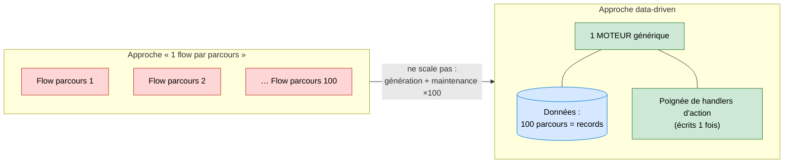

## 2. Modèle — DÉFINITION du parcours

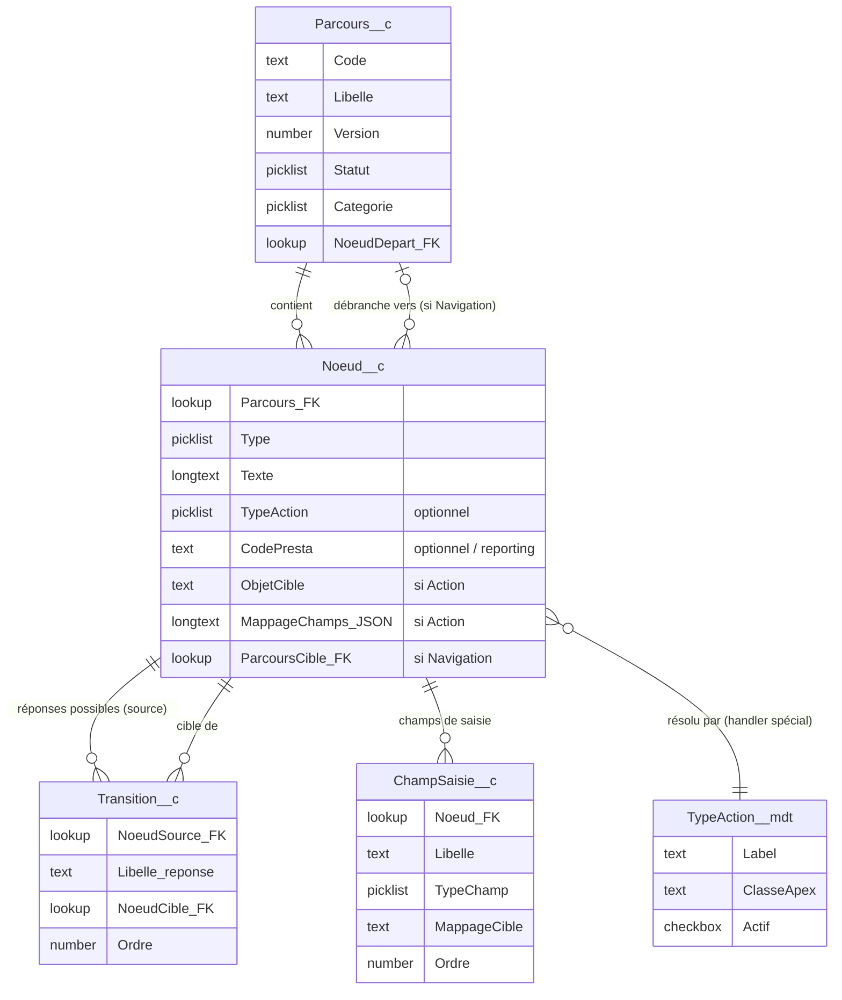

> ℹ️ **ChampSaisie__c** (nouveau) couvre les écrans qui **collectent** sans brancher (ex. l'écran Identification : nom / tél / mail).
> `MappageCible` recopie la valeur saisie vers une fiche : **chemin** dont le **dernier segment = le champ** et le **préfixe = le record cible**, racine = jeton de session (`{client}.Phone`, `{client}.PersonEmail`, `{case}.Subject`) — résolu quelle que soit l'origine (Case ou Account), avec **un seul `update` par record**. Vide → la valeur n'est que tracée dans `ReponseSaisie__c`.
> Un nœud **Action** porte `TypeAction` (le **verbe DML** : Créer / Mettre à jour / Supprimer), `ObjetCible` (QUEL objet) + `MappageChamps_JSON` (QUELS champs ; pour Mettre à jour / Supprimer, le JSON porte l'`Id` cible via un jeton). Un nœud = **un seul record** ; une action qui touche plusieurs records = **plusieurs nœuds Action enchaînés** (voir §9). `Delai` et `Parametres_JSON` sont supprimés : la date/priorité vit désormais dans le JSON. `CodePresta` est conservé comme **libellé reportable** (optionnel).
> Un nœud **Navigation** porte `ParcoursCible_FK` (vers quel autre `Parcours__c` débrancher) — voir §7b.

## 3. Modèle — EXÉCUTION (les résultats) — origine GÉNÉRIQUE

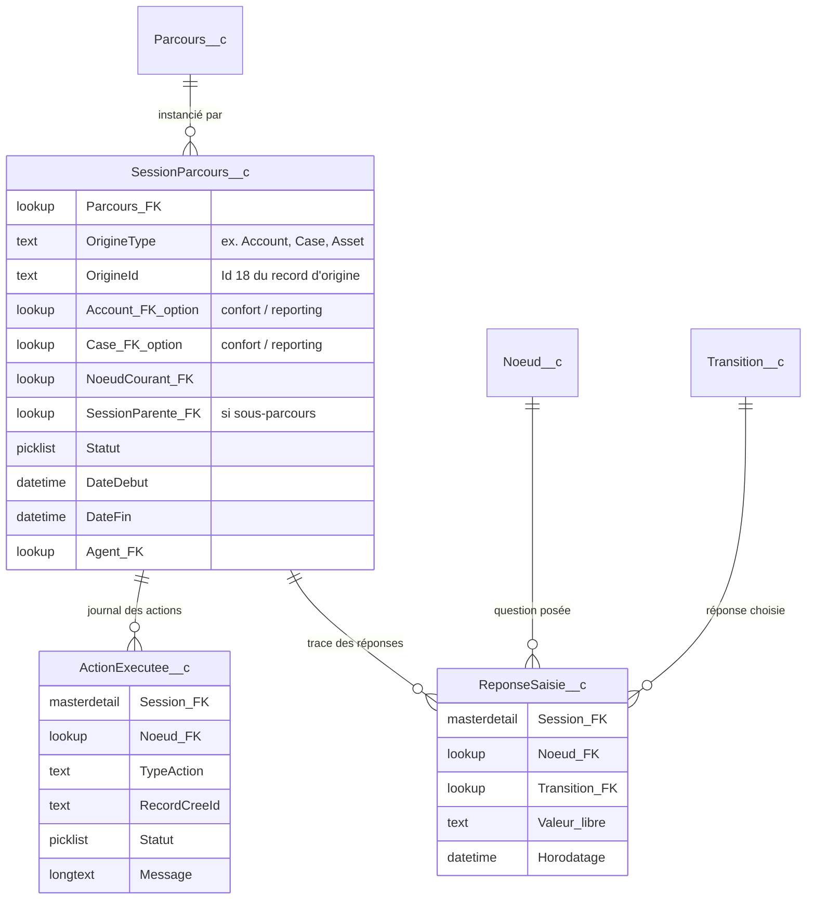

| Objet | Rôle |
| --- | --- |
| `SessionParcours__c` | **Une exécution**. Origine **générique** : `OrigineType` + `OrigineId` (tout objet, **0 modif de schéma**). Lookups Account/Case = **confort** optionnel (reporting natif), pas la source de vérité. |
| `ReponseSaisie__c` | **Chaque réponse** donnée : quelle question, quelle transition choisie (ou valeur libre). → alimente le commentaire fusionné + l'analytics. |
| `ActionExecutee__c` | **Journal des créations** (WorkOrder, Events…) : Id du record créé, OK/Erreur. → audit + **idempotence** (ne pas recréer si retour arrière). |

> ✅ **Origine générique :** `OrigineType` + `OrigineId` permettent de lancer un parcours depuis **n'importe quel objet** sans ajouter de champ. Salesforce n'autorise pas de lookup polymorphe *custom* → c'est le pattern recommandé. Les lookups Account/Case ne sont ajoutés que si un **reporting natif** croisé le justifie (dérivés — ex. `Case.AccountId` donne le compte gratuitement). Compromis : pas d'intégrité référentielle ni de related list native → voir 3b.

### 3b. Related list générique — LWC « Parcours lancés »

> ℹ️ Sans lookup typé, on restitue l'historique sur **n'importe quelle** page (Account, Case, Asset…) via un composant qui lit les sessions par `OrigineId` — UX générique, 0 champ par objet.

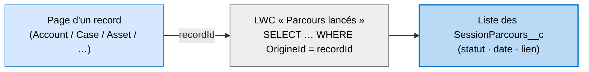

## 4. Comment sont générées les réponses d'une question ?

> ℹ️ Les choix d'une question **SONT ses `Transition__c` sortantes**. Pas d'objet « réponse » séparé : le libellé affiché et le routage sont le **même** record. Le moteur affiche un radio dont les options = les `Libelle_reponse` triés par `Ordre`.

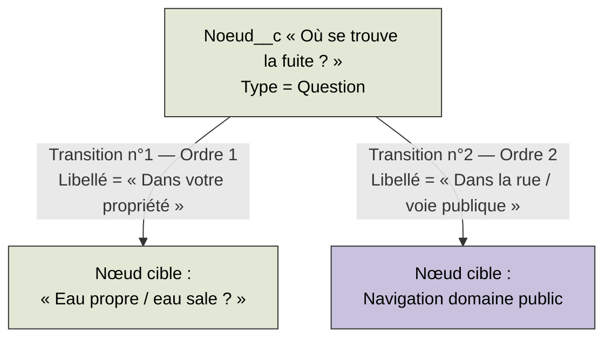

> ℹ️ « Oui / Non » = 2 transitions. « Dans votre propriété / Dans la rue » = 2 transitions. Pour un écran de **saisie** (nom, tél…), ce ne sont pas des transitions mais des `ChampSaisie__c`.

## 5. Lancer un parcours depuis un Account / un Case

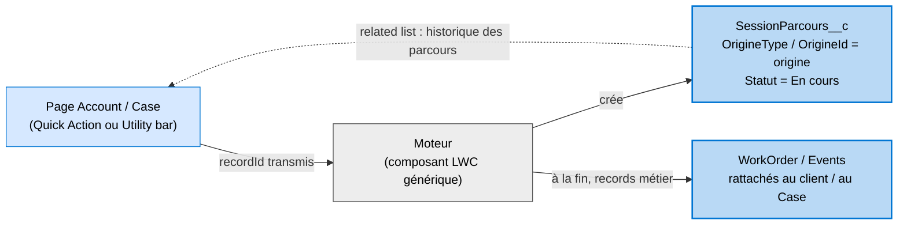

> ℹ️ Le moteur est posé sur la **page Account/Case** et reçoit le `recordId` → il crée la `SessionParcours__c` liée. Les records créés en fin de parcours sont naturellement rattachés (WorkOrder → Case/Compte, Events → client). La **related list** donne l'historique des parcours sur la fiche.

## 6. Choisir le parcours à déclencher

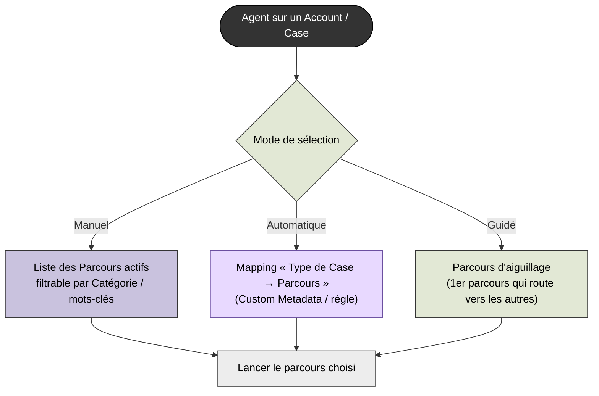

> ℹ️ Trois leviers, combinables : **manuel** (liste filtrée par `Categorie__c`), **automatique** (ex. Case « Fuite » → parcours mappé), **guidé** (un parcours d'aiguillage qui pose le motif et navigue — cohérent avec le modèle : Navigation = transition inter-parcours).

## 7. Le moteur (un seul composant LWC générique)

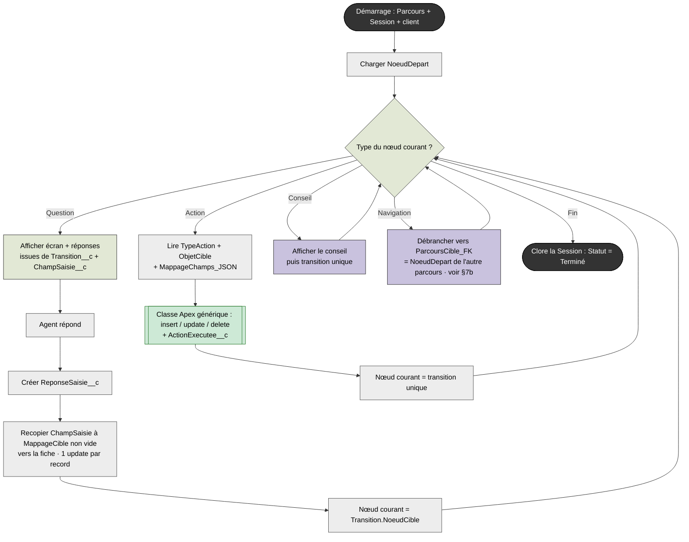

> ⚠️ Le moteur est **un seul composant LWC générique**, écrit **une seule fois** : il lit le nœud courant, affiche l'écran adapté (question + réponses issues de `Transition__c`, champs issus de `ChampSaisie__c`, conseil…), persiste la réponse via Apex, exécute les actions, puis avance au nœud suivant et se re-rend. On ne génère **plus jamais** un flow par parcours — et on échappe au mur de génération des gros flows rencontré précédemment. Les 100 parcours restent de la pure **donnée**. Le LWC peut, si besoin, être encapsulé dans un Flow pour le packaging admin, mais le rendu dynamique et la boucle sont portés par le LWC.

## 7b. Débrancher vers un autre parcours (nœud Navigation)

> ℹ️ Révélé par le 2ᵉ parcours (**EP – FUITE DOMAINE PUBLIC**) : « Dans votre propriété → **Aller à Fuite domaine privé** », « Eau sale → **Aller à Assainissement** ». Un nœud **Navigation** n'affiche rien : il **passe la main** à un autre parcours, désigné par `ParcoursCible_FK`. C'est une **donnée** (un lookup), pas du code — donc réutilisable par les 100 parcours sans rien générer.

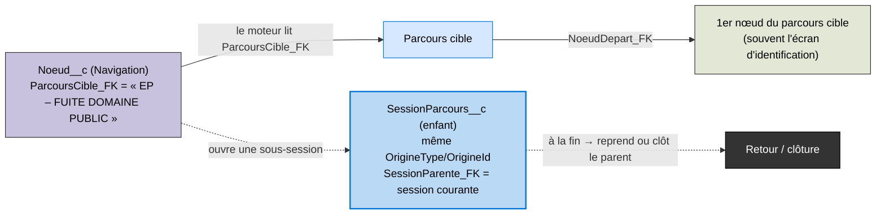

| Point | Comment ça marche |
| --- | --- |
| **Cible** | Le nœud Navigation porte `ParcoursCible_FK` → le moteur charge le `NoeudDepart_FK` du parcours visé et continue la boucle. Aucune transition sortante nécessaire (le débranchement remplace la suite). |
| **Traçabilité** | Recommandé : ouvrir une **sous-session** (`SessionParcours__c` enfant, `SessionParente_FK` = session courante, même `OrigineType`/`OrigineId`). Chaque parcours garde son propre journal de réponses et d'actions ; le lien parent↔enfant reconstitue le parcours complet du client. |
| **Hand-off vs retour** | Dans ces logigrammes, « Aller à X » est un **transfert** (on ne revient pas) → le parent se clôt quand l'enfant démarre. Si un jour un « retour » est voulu (sous-routine), `SessionParente_FK` permet déjà de reprendre le parent là où il s'était arrêté (`NoeudCourant_FK`). |
| **Boucles** | Garde-fou simple : interdire qu'un parcours se rappelle lui-même en chaîne (détection via la chaîne `SessionParente_FK`). |

> ✅ **C'est le seul vrai manque que le 2ᵉ parcours a révélé** — et il se comble par **1 lookup sur `Noeud__c`** (`ParcoursCible_FK`) + **1 lookup d'audit sur `SessionParcours__c`** (`SessionParente_FK`), sans nouvel objet. Bonus : la cible « domaine public » **existe désormais** (ce parcours), et l'écran d'identification est **mutualisé** entre parcours.

## 8. Une seule classe générique : « la donnée décrit, le code exécute »

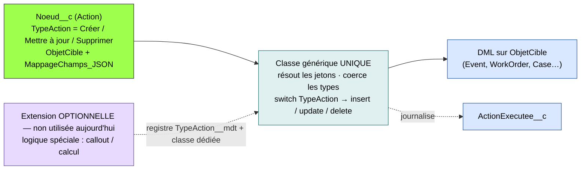

> ℹ️ **Toute action = un DML sur un record.** Qu'il s'agisse d'un **Event** (RV) ou d'un **WorkOrder** (intervention), c'est **la même opération** : créer / mettre à jour / supprimer un `ObjetCible` avec les champs de `MappageChamps_JSON`. Donc **une seule classe générique** (plus de `PriseRVHandler` / `InterventionHandler` distincts) : elle lit `TypeAction` (le verbe DML), résout les jetons (`{client}`, `{case}`, `TODAY+N`, `{noeud.CodePresta}`), coerce les types et exécute l'`insert` / `update` / `delete` (voir §9), **sans code par parcours**. Le registre `TypeAction__mdt` + une classe dédiée ne deviennent utiles que si, un jour, une action n'est **pas** un simple DML (callout, calcul) — **aucun cas aujourd'hui**.

## 9. Les actions = création de records (exemple EP – FUITE)

> ℹ️ **Principe (déclaratif) :** un nœud **Action** ne contient **aucune logique en dur**. Il porte `ObjetCible` (quel objet) + `MappageChamps_JSON` (quels champs) et crée **un seul record**. Une action métier qui crée plusieurs records (ex. un RV = 2 Events) = **plusieurs nœuds Action enchaînés** par des transitions. Un **unique handler générique** résout les jetons (`{client}`, `{case}`, `TODAY+3`, `{ampleur}`, `{noeud.CodePresta}`) et insère — **aucun code par parcours**. Besoin de 2 Events ? → **2 nœuds**.

### 9a. « Prise de RV J+3–J+9 » → 2 Events (2 nœuds Action enchaînés)

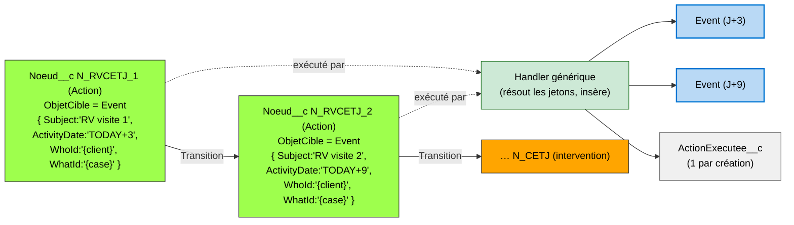

> ℹ️ **Compromis assumé (modèle B) :** une action « 2 Events » occupe 2 nœuds au lieu d'un seul → on perd le mapping 1 case du logigramme = 1 nœud, et l'atomicité de création (les 2 Events ne sont plus insérés dans la même transaction). Mitigé par `SessionParcours__c.NoeudCourant` (reprise) et `ActionExecutee__c` (idempotence). En échange : **zéro objet enfant**, le moteur boucle déjà sur les nœuds — aucune machinerie nouvelle.

### 9b. « Intervention CET05 <48h » → 1 Work Order (1 nœud Action)

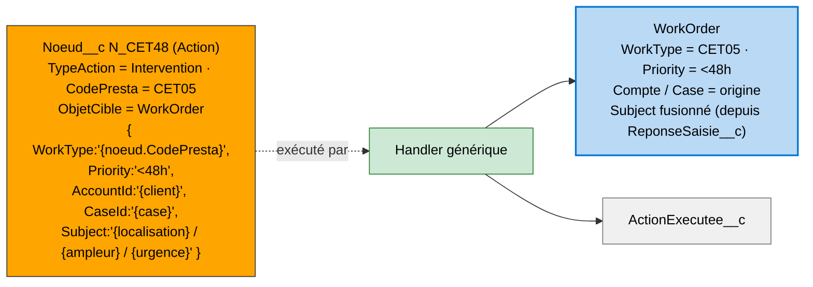

> ℹ️ **Pourquoi un handler, et pas un simple `insert` ?** Les valeurs du JSON sont des **jetons** (`TODAY+3`, `{client}`, `{noeud.CodePresta}`, `{ampleur}`), pas des valeurs natives — ils n'existent qu'à l'exécution. Un **résolveur générique** (écrit **une seule fois**) : (1) crée le SObject dynamiquement (`ObjetCible`), (2) résout chaque jeton, (3) **coerce** la String en type du champ (Date / Id / Number), puis (4) `insert` + `ActionExecutee__c`. Aucun code spécifique à un parcours. C'est aussi pourquoi un champ `Delai` séparé est inutile : le résolveur transforme déjà `TODAY+N` en date.
> **Gravité SLA (`Priority`) :** le 2ᵉ parcours (domaine public) utilise **3 niveaux** issus de la légende du logigramme — **Urgent** (rouge), **<48h** (orange), **J+2–J+7** (jaune). Ce sont **3 valeurs de la picklist `WorkOrder.Priority`**, portées par le JSON du nœud — aucune logique en dur, juste la bonne valeur par nœud Action.

> ⚠️ **Vigilance :** création au **bon moment** (confirmation agent) ; **idempotence** via `ActionExecutee__c` (ne pas recréer si l'agent revient en arrière) ; gestion d'erreur (échec → message, parcours non bloqué).

## 10. Visualisation : deux viewers graphiques (implémentés)

> ✅ **Implémenté.** La visualisation initialement envisagée (génération Apex → Mermaid) a été remplacée par **deux composants LWC** au rendu **SVG interactif**, qui lisent directement les records. Disposition en couches via la ressource statique **dagre** (repli BFS si indisponible), zoom et légende colorée par type de nœud. Même nature graphique pour les deux.

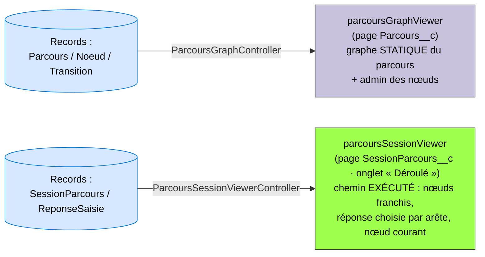

| Viewer | Source lue | Ce qu'il montre |
| --- | --- | --- |
| **`parcoursGraphViewer`** (page `Parcours__c`) | `Noeud__c` + `Transition__c` du parcours | Le **graphe statique** complet du parcours (toutes les branches possibles), avec administration inline des nœuds. |
| **`parcoursSessionViewer`** (page `SessionParcours__c`, onglet **« Déroulé »**) | `ReponseSaisie__c` triées par `Horodatage__c` + `NoeudCourant_FK__c` | Le **chemin réellement suivi** par une exécution : nœuds franchis dans l'ordre, **réponse choisie** portée par chaque arête, **valeurs saisies** dans un panneau de détail, **nœud courant** surligné. Les arêtes reliant les nœuds consécutifs du chemin, un saut vers un sous-parcours apparaît naturellement. |

## 11. Trajectoire de migration (incrémentale, sans risque)

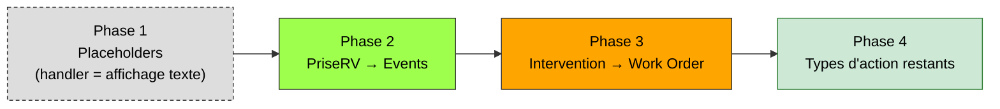
